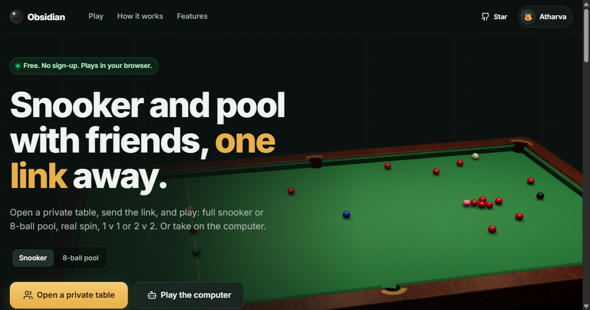
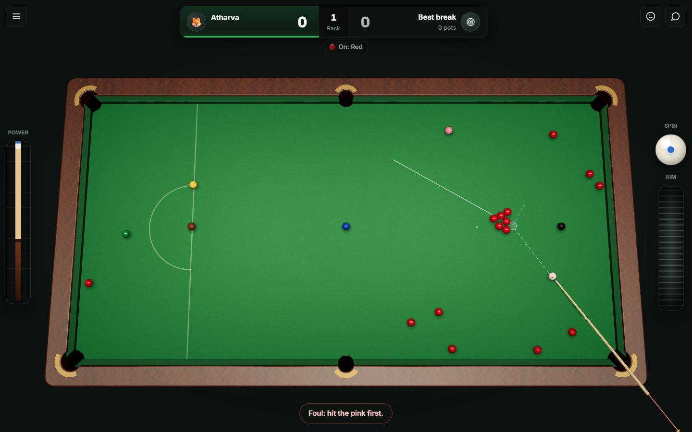
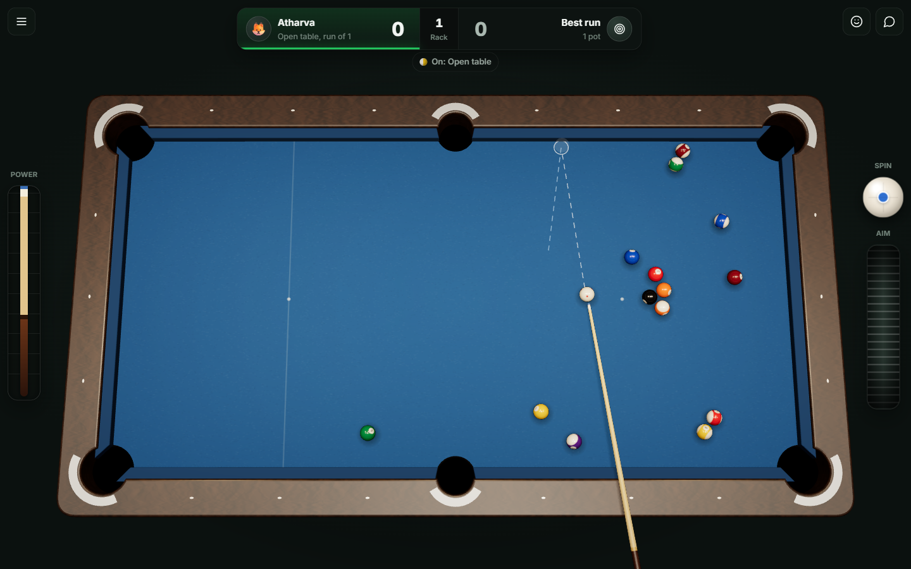
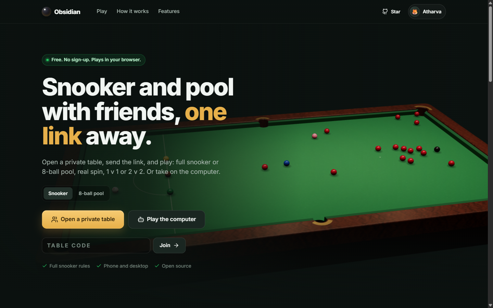
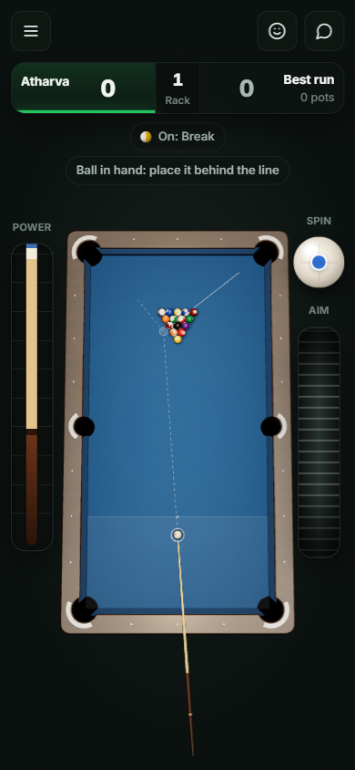
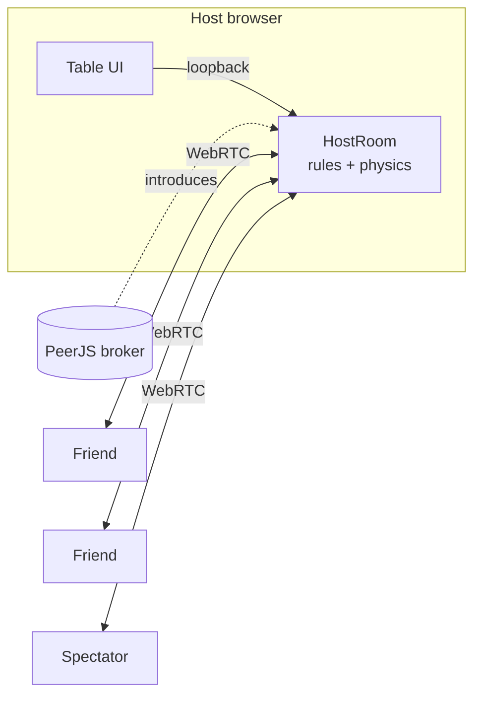

<div align="center">

<a href="https://baize-club.vercel.app"></a>

# Obsidian

**Private online snooker and 8-ball pool for you and your friends.**
Open a table, send the link, play. Or take on the computer. No accounts, no downloads, no lobbies full of strangers.

[](https://baize-club.vercel.app)
[](https://github.com/AtharvaLakhe/baize-club/stargazers)
[](https://github.com/AtharvaLakhe/baize-club/actions)
[](LICENSE)

</div>

---

## Why

Every online snooker and pool game wants you to sign up, grind levels and play strangers. Sometimes you just want to play your mate across town. Obsidian is a private table you can open in a couple of seconds: the link *is* the invite.

## What's in it

**Two games, properly ruled**
- **Snooker:** reds and colours, fouls valued correctly, colours respotted to the right spot (or the highest free one), free ball when you're snookered after a foul, *put him back in*, and a re-spotted black on a tie. 15, 10, 6 or 3 reds.
- **8-ball pool:** on a 9-foot table with numbered solids (1–7), stripes (9–15) and the 8. Break from the kitchen, open table until the first legal pot, ball in hand anywhere after a foul, and the 8 last. Sink it early and you lose.
- Single frames or best of 3, 5 or 7. **Singles (1 v 1) or doubles (2 v 2)** with real doubles rotation: A1, B1, A2, B2.

**A computer that actually plays**
- Easy, Medium or Hard. It doesn't fake it: every candidate shot is played out with the real physics and scored with the real rules, and it plays safe when nothing is on. The harder levels look further ahead and wobble less.

**It feels like a shot**
- Spin-aware physics: the cue ball slides, then rolls. Screw back, follow through, stun, and side that bends off the cushions.
- Real 3D table built from the same geometry the physics uses: lamp-lit clear-coated balls, numbers that roll with the pool balls, diamond sights on the pool rails, and a spotted cue ball that shows the spin.
- A cue that winds back, drives through and follows through. Chalk dust, impact flashes, hit-stop on big contacts, camera shake on a full-power break.
- Layered synthesized audio (no sound files): the tip's *thock*, resin clacks, cushion thumps, the pocket drop, a rolling rumble and a little room reverb.
- Familiar controls: a power bar on one edge and a fine-aim wheel and spin ball on the other, swapped for left-handers.

**Yours**
- Seven cloths (championship green, tournament blue, claret, plum, slate, saffron, midnight neon) and seven cues.
- House rules: shot clock, aiming guide (full paths, ghost ball, line, or none) and party rules: **bucket pockets**, **ice cloth**, **rubber cushions** and **marbles**.
- Numbers on the balls for anyone who finds the colours hard to tell apart.

**With friends**
- Invite by link, code or QR. Extra people who join watch.
- Your opponent's cue moves live as they line up.
- Chat, emoji reactions, instant replay at half speed, and a result card you can share after the match.
- Practice alone, play the computer, or pass-and-play on one device.

<p align="center">
  
  
</p>
<p align="center">
  
  
</p>

## How it works

There is no game server. The browser that opens the table becomes the **host**; friends connect to it directly over WebRTC data channels. The public [PeerJS](https://peerjs.com) broker only introduces the browsers to each other.



1. The player at the table sends only the shot: aim, power and tip position.
2. The host runs the physics to completion, scores it with the rules engine, and broadcasts the shot plus the resulting state.
3. Every screen replays the shot in real time with the same physics. The step uses only `+ − × ÷` and `sqrt`, so it lands in the same place in every browser; the host's state is applied at the end regardless.

The physics models each ball's velocity and the velocity of its contact patch. While they disagree the ball slides and cloth friction pulls them together; when they cancel it rolls. That's what makes screw, follow and stun come out naturally rather than being faked.

If the host reloads, the table reopens on the same code and friends can rejoin with the link they already have.

## Controls

| | Desktop | Phone |
|---|---|---|
| Aim | Point with the mouse (hold `Shift` for fine aim) | Touch the table where you want to aim |
| Fine aim | The ridged wheel, the mouse wheel, or the arrow keys | Drag the ridged wheel |
| Power and shoot | Drag the power bar down and let go, or click and drag back on the table | Drag the power bar down, let go |
| Spin | Click the white ball (`W A S D` when focused) | Tap the white ball |
| Ball in hand | Drag the cue ball: in the D (snooker), behind the line (pool break) or anywhere (pool foul) | Same |

Left-handed? Turn on *Left-handed controls* in the menu to swap the power bar and the aim wheel.

## Run it locally

```bash
git clone https://github.com/AtharvaLakhe/baize-club.git
cd baize-club
npm install
npm run dev      # http://localhost:5173
npm test         # physics and rules tests
npm run build
```

Open two tabs to play yourself online.

## Project layout

```
src/
  core/      table geometry, physics, snooker and 8-ball rules, computer opponent: pure and tested
  net/       protocol, host authority, PeerJS transport, client session
  game/      real-time shot playback and ball orientation
  render/    three.js table, balls, cue, effects, themes
  audio/     synthesized sound
  ui/        home, lobby, game screen, share card
tests/       vitest suites for physics, both rulebooks and the computer opponent
```

More detail in [docs/ARCHITECTURE.md](docs/ARCHITECTURE.md).

## Contributing

Ideas, bug reports and pull requests are very welcome. See [CONTRIBUTING.md](CONTRIBUTING.md). Things that would be lovely:

- 9-ball and straight pool on the same engine
- Swerve and masse
- A trick-shot editor with shareable layouts
- More cloths and cues

## Credits

Made by **[Atharva Lakhe](https://github.com/AtharvaLakhe)**.

If Obsidian made you smile, a ⭐ helps other people find it.

## License

[MIT](LICENSE)
